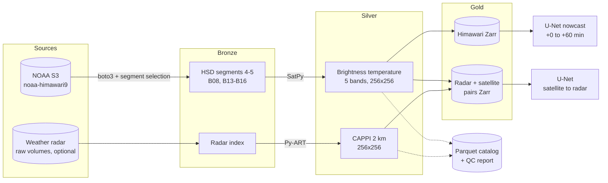

# HCMC Storm Nowcasting

**An end-to-end data pipeline and deep-learning nowcasting model for convective clouds over Ho Chi Minh City, built from raw Himawari-9 geostationary satellite data.**

Full-disk Himawari-9 files are pulled from the NOAA open-data bucket on AWS, cut down to the few segments that cover southern Vietnam, calibrated to brightness temperature, regridded onto a 256×256 km grid centred on the Nha Be weather radar, quality-checked and published as a chunked Zarr dataset. A U-Net then forecasts the next 60 minutes of cloud-top temperature, and its skill at predicting deep-convective (cold) cloud is compared against persistence and optical-flow extrapolation.

The pipeline also contains a radar branch (raw radar volumes → CAPPI with Py-ART, paired with the satellite frames), which is tested on synthetic volumes and ready for when radar data is available.

> Status: pipeline verified on real Himawari data (2025-08-01 08:00 UTC, see `reports/`); full-month run and model results in progress.

---

## Architecture



Orchestrated as daily-partitioned **Dagster** assets; the same steps run from a plain CLI and from Kaggle/Colab notebooks (the heavy download runs next to the data, only the regridded output comes back).

## Engineering highlights

| Problem | Solution |
|---|---|
| A full-disk scan for 5 bands is ~550 GB/month | Compute the needed segments from the satellite's fixed-grid navigation equations, so only segments 4-5 are downloaded (**~110 GB/month, 80% less**); keep only regridded output (~1% of raw) |
| Slow residential link to us-east-1 (~30 KB/s per stream) | Ingest runs on Kaggle/Colab next to the data; raw files are deleted right after processing and only the regridded output is kept |
| A satellite file timestamp is not the observation time | The disk is scanned north to south; HCMC is observed **~4 min after** the nominal time (measured), so the real observation time is stored and used for alignment |
| Missing / corrupt files (e.g. 141/144 timesteps on 2025-08-01) | Frame-level QC (range, NaN fraction, flat fields, time gaps) in a Parquet catalog; forecast windows that span a gap are dropped |
| Train/test leakage in time series | Day-blocked splits, and each input+target window must lie entirely inside one split |
| Re-runs | Idempotent steps: cached downloads, skip-if-exists outputs, per-day catalog partitions, atomic writes, catalog paths relative to the data root (portable between Colab and local) |

## Results

| Metric | Value |
|---|---|
| Himawari files / volume ingested | _tbd_ |
| Frames passing QC | _tbd_ |
| Processing time per timestep (SatPy, 10 files) | 16 s (local CPU) |
| Gold dataset size | _tbd_ |

**Nowcasting skill on held-out days (27–31 Aug):** CSI for cold cloud (B13 ≤ 235 K)

| Method | +10 min | +30 min | +60 min |
|---|---|---|---|
| Persistence | | | |
| Optical flow (Farneback) | | | |
| U-Net (4 input frames, residual) | | | |

## Quickstart

```bash
mamba env create -f environment.yml && conda activate stormcast
pip install -e ".[dev,orchestration,ml]"
pytest

stormcast segments                                                   # -> [4, 5]
stormcast himawari-download --start 2025-08-01 --end 2025-08-01
stormcast himawari-process  --start 2025-08-01 --end 2025-08-01
stormcast build-sat && stormcast report
python -m stormcast.ml.train_nowcast

dagster dev -f src/stormcast/orchestration/dagster_defs.py           # UI with lineage + backfills
```

On a slow connection, run next to the data instead:
- **Kaggle** (runs in the background): [notebooks/kaggle_himawari.ipynb](notebooks/kaggle_himawari.ipynb) (CPU, internet on) → add its output as input to [notebooks/kaggle_train_nowcast.ipynb](notebooks/kaggle_train_nowcast.ipynb) (GPU T4).
- **Colab**: `python scripts/package_for_colab.py`, upload `dist/stormcast-code.zip` to `MyDrive/stormcast/`, run [notebooks/colab_himawari.ipynb](notebooks/colab_himawari.ipynb) then [notebooks/colab_train_nowcast.ipynb](notebooks/colab_train_nowcast.ipynb).

Radar branch (when data is available): `stormcast radar-index --archive radar.zip`, `radar-process`, `align`, `build`, then `python -m stormcast.ml.train`.

All settings (grid, bands, tolerances, QC thresholds, splits, model) live in [configs/default.yaml](configs/default.yaml).

## Repository layout

```
configs/default.yaml           pipeline + training configuration
src/stormcast/
  geos.py                      Himawari fixed-grid navigation -> which segments to download
  grid.py                      the shared 256x256 target grid
  ingest/                      S3 download (Himawari), archive index (radar)      [bronze]
  process/                     SatPy calibration + resampling, Py-ART CAPPI       [silver]
  align.py, build_dataset.py   time matching, Zarr writers                        [gold]
  quality.py, report.py        QC rules + markdown data-quality report
  catalog.py                   per-day Parquet catalog (query with DuckDB)
  pipeline.py, cli.py          steps + command line
  orchestration/dagster_defs.py
  ml/nowcast.py, train_nowcast.py   satellite nowcasting (U-Net vs persistence / optical flow)
  ml/dataset.py, train.py           satellite -> radar retrieval
  ml/metrics.py, baselines.py, unet.py
notebooks/                     Kaggle / Colab ingest (CPU) and training (GPU)
scripts/                       quick-look figures, Colab packaging
tests/                         unit + integration tests (incl. synthetic radar and a training smoke run)
```

## Data

- **Himawari-9 AHI L1b**: NOAA Open Data Dissemination, `s3://noaa-himawari9` (public, no credentials).
- Grid centre: Nha Be weather radar site (10.6596°N, 106.7283°E).

## Limitations

- Cloud-top temperature is a proxy for convection; there are no lightning or rain-gauge labels in this version.
- One month (August 2025, wet season) to start with; more months are a config change away.
- No parallax correction yet: tall storm tops appear displaced by a few km at this viewing angle.

## Tech stack

Python · SatPy / pyresample · Py-ART · xarray · Zarr · Dask · boto3 · Parquet / DuckDB · Dagster · Docker · GitHub Actions · PyTorch · OpenCV · MLflow · Google Colab
